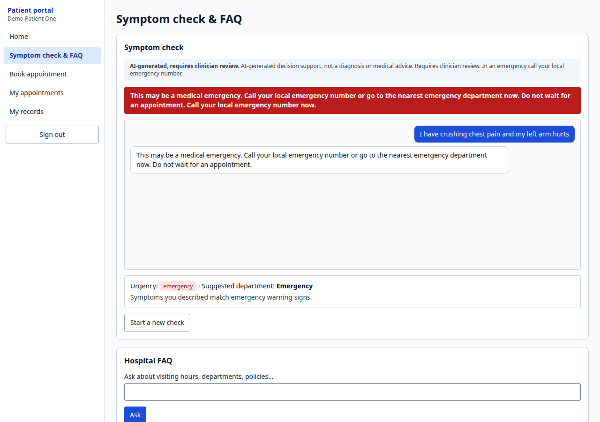
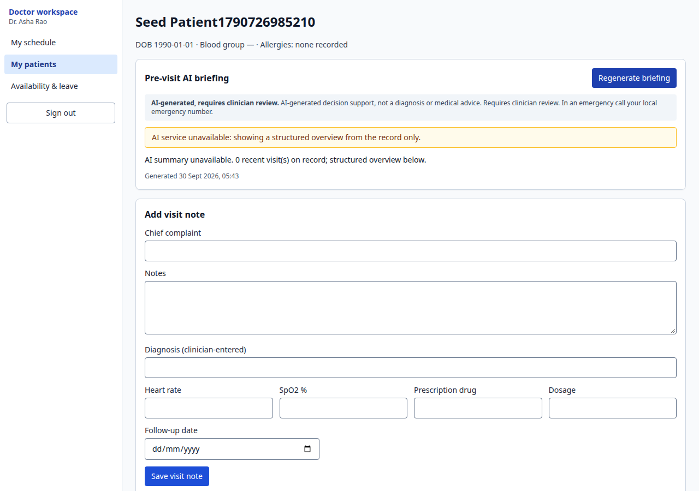
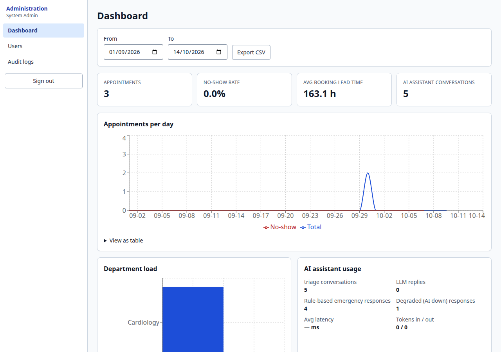

# AI Hospital Management Assistant

Patient management, appointment scheduling, medical-record organisation and AI-assisted triage, summaries and FAQ for a hospital.
Four roles (admin, doctor, reception staff, patient) with server-side RBAC, a full audit trail and a design that keeps working when the AI is down.

> **Safety boundary.** The AI provides *decision support and administrative automation only*. It never diagnoses, never recommends medication, and every clinical-adjacent output is marked **"AI-generated, requires clinician review"**. Emergency red flags are detected by deterministic rules *before and independently of* the LLM.
> Designed with HIPAA-style safeguards; **this is not a compliance certification** (see `docs/SECURITY.md`).

| | |
|---|---|
| Backend | Python 3.14, FastAPI, SQLAlchemy 2 (async), Alembic, Pydantic v2, PostgreSQL 16, APScheduler |
| Frontend | Next.js 15 (App Router, TypeScript), Tailwind, Recharts, typed client generated from OpenAPI |
| AI | Anthropic API (model from `ANTHROPIC_MODEL`) for triage, booking assistant (tool use), summaries, FAQ |
| Ops | Docker Compose, Caddy (automatic HTTPS), Redis (shared rate limits), GitHub Actions CI/CD, encrypted backups |

## Screenshots
| Patient symptom check | Doctor chart + AI briefing | Admin dashboard |
|---|---|---|
|  |  |  |

## Run it locally (about 10 minutes, mostly the first image build)
Prerequisites: Docker with the Compose plugin (v2), `make`, `python3` (only used to generate secrets). Ports 3000, 8000 and 5433 must be free.

```bash
git clone git@github.com:randomPlayerHere/hospital-ai-assistant.git && cd hospital-ai-assistant
make up          # creates .env with random secrets, builds images, starts db + api + worker + web, applies migrations
make seed        # roles, departments, 6 demo doctors with Mon-Fri 09-17 availability, staff, admin, 3 synthetic patients
```
Open **http://localhost:3000** and sign in with a demo account (password `DemoPass!12345`; admin: `admin@hospital.example.com` / `ChangeMe!12345`):
`patient1@example.com`, `staff@hospital.example.com`, `doctor1@hospital.example.com` (Cardiology), `admin@hospital.example.com`.
API docs: http://localhost:8000/docs · health: `/healthz`, `/readyz`.
`make down` stops everything (`docker compose ... down -v` also wipes the database).

**Enable live AI** (optional): put your key in `.env` (`ANTHROPIC_API_KEY=...`, optionally `ANTHROPIC_MODEL`), then `make up` again. Without a key the app is fully usable; triage still flags emergencies and offers direct booking, FAQ returns excerpts, briefings fall back to a structured overview.

## Configuration (`.env`, see `.env.example`)
| Variable | Purpose |
|---|---|
| `SECRET_KEY` | JWT signing key (rotate to log everyone out) |
| `FIELD_ENCRYPTION_KEY` | Fernet key for column-level encryption of insurance IDs. **Back it up.** |
| `DATABASE_URL` / `MIGRATION_DATABASE_URL` | Runtime (DML-only) and migrator (schema owner) DB roles |
| `ANTHROPIC_API_KEY`, `ANTHROPIC_MODEL`, `ANTHROPIC_EFFORT`, `AI_ENABLED` | AI provider settings (`ANTHROPIC_EFFORT` optional) |
| `CORS_ORIGINS`, `HOSPITAL_TIMEZONE` | Allowed browser origins; slot generation and display timezone |
| `STORAGE_BACKEND` (`local`/`s3`), `UPLOAD_DIR`, `S3_*` | Document storage |
| `EMAIL_BACKEND` (`console`/`smtp`), `SMTP_*` | Password reset and reminders (console logs them in dev) |
| `REDIS_URL` | Shared rate-limit counters across workers (prod compose sets it) |
| `SENTRY_DSN` | Error tracking (optional) |
| `NEXT_PUBLIC_API_URL` | API base URL baked into the frontend build (empty = same origin, used in production behind Caddy) |
Production variables: `.env.prod.example`.

## Develop and test
```bash
make backend-venv                     # Python 3.14 venv with dev tools (needs the db container from `make up` on :5433)
make test                             # backend pytest (coverage) + frontend Vitest
make lint                             # ruff, black, mypy, eslint, tsc
make e2e                              # starts the stack with rate limits off and runs Playwright (register -> triage -> book -> doctor -> admin, a11y)
make load-test                        # k6, 50 users; see docs/LOADTEST.md
make api-docs                         # regenerate docs/API.md and the typed frontend client
python -m app.ai.evals.run [--live]   # triage eval (rules always; LLM needs a key) -> backend/app/ai/evals/REPORT.md
```
Results from local runs on 2026-09-30: 132 backend tests at 95 % coverage (CI gate 80 %), 18 frontend unit tests, 13 Playwright tests (full role flow + axe WCAG 2.1 AA scans of every main page), 0 npm/pip audit findings, Trivy clean (no fixable HIGH/CRITICAL). **New npm advisories have appeared since then; see `to_Do.md` for current CI status.**

## Documentation
| Doc | Contents |
|---|---|
| `to_Do.md` | **Start here if you're joining the project:** what's done, what's still needed, setup |
| `docs/USER_GUIDE.md` | What each role can do, step by step |
| `docs/DEMO.md` | 10-minute demo script |
| `docs/ARCHITECTURE.md` | System diagram, ER diagram, design points |
| `docs/API.md` | Endpoint reference (generated) |
| `docs/SECURITY.md` | Threat model, PHI handling, test results |
| `docs/RUNBOOK.md` | First-time server setup, deploy, rollback, backup/restore, incidents |
| `docs/LOADTEST.md` | Load-test method, results and what it uncovered |
| `docs/DECISIONS.md` | Assumptions and deviations from the brief |
| `backend/app/ai/evals/REPORT.md` | Triage evaluation report |

## Repository layout
`backend/` API, models, migrations, AI layer, tests · `frontend/` Next.js app, unit and E2E tests · `infra/` compose files, Caddyfile, scripts (deploy, smoke, backup, restore, provision) · `knowledge_base/` FAQ documents for the bot · `loadtest/` k6 · `.github/workflows/` CI and deploy.

## Deployment
Push a `v*` tag: GitHub Actions builds/pushes images to GHCR, SSHes to your server, runs migrations, restarts, smoke-tests (register → login → book → AI triage → admin dashboard) and rolls back automatically on failure. Server setup and operations are in `docs/RUNBOOK.md`. The deploy pipeline and scripts were rehearsed locally against the production compose file; a live public deployment requires your domain, server and registry credentials.
