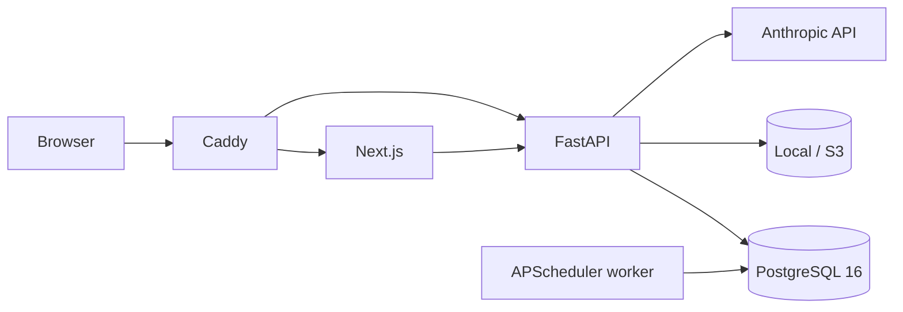
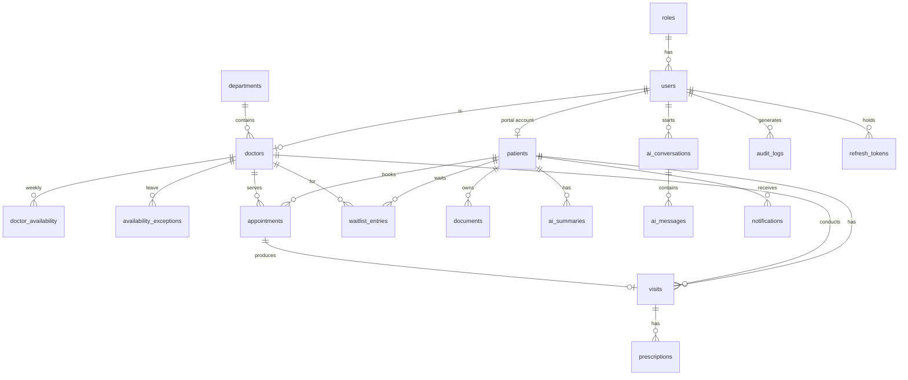

# Architecture

ER diagram is added in Phase 2.

## ER diagram

Key constraints: GiST exclusion `ex_appointments_no_overlap` (no overlapping booked/completed appointments per doctor);
`visits.search_vector` generated `tsvector` with GIN index; `deleted_at` on clinical tables; `record_versions` snapshots every edit.
