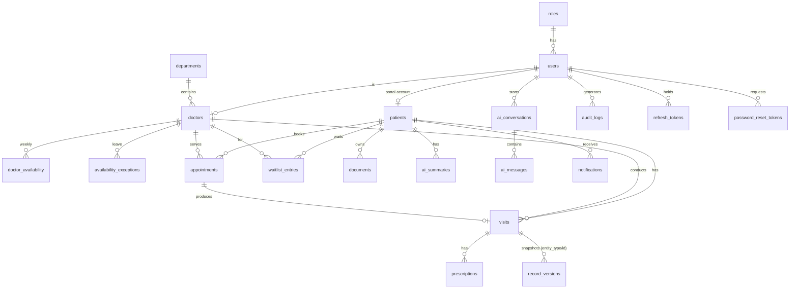

# Architecture

## System diagram
```mermaid
flowchart LR
  U[Browser: patient / staff / doctor / admin] -->|HTTPS| C[Caddy<br/>TLS + routing]
  C -->|/api, /healthz, /readyz| API[FastAPI x4 workers]
  C -->|everything else| FE[Next.js standalone]
  FE -. same origin API calls from the browser .-> C
  API --> DB[(PostgreSQL 16)]
  API --> R[(Redis<br/>rate-limit counters)]
  API --> ST[(Storage: local volume / S3)]
  API -->|timeouts, retries, circuit breaker| LLM[Anthropic API]
  W[Worker: APScheduler<br/>reminders] --> DB
  API --> KB[[knowledge_base/*.md]]
  B[Backup cron: pg_dump | age] --> DB
```

## Backend layout (`backend/app`)
- `api/` routers: `auth`, `admin`, `analytics`, `patients`, `visits` (visits, prescriptions, versions), `documents`, `scheduling` (doctors, availability, slots, appointments, waitlist), `search`, `ai`, `health`.
- `core/`: config, DB sessions (separate small pool for audit writes), security (argon2id, JWT), RBAC dependencies, audit + request-context ASGI middleware, rate limiting, field encryption.
- `services/`: access control (`access.py` is the single place for object-level authorization), scheduling engine, auth flows, storage, virus-scan hook, notifications, versioning.
- `ai/`: `client.py` (LLM wrapper: timeout, retry/backoff, circuit breaker, usage logging), `prompts/*.vN.md` (versioned prompts), `redflags.py` (rule-based emergency detection), `triage.py`, `booking.py` (read-only tools + confirmation), `summarize.py`, `faq.py` (TF-IDF retrieval), `guards.py` (no diagnosis/medication), `pii.py`, `structured.py` (JSON + Pydantic validation, one retry), `evals/`.
- `jobs/`: reminder job (24 h / 2 h, idempotent) and the APScheduler worker.

## Key design points
- **No double booking**: booking takes a row lock on the doctor, re-checks the generated slot, and the database enforces it with a GiST exclusion constraint on `(doctor_id, tstzrange(starts_at, ends_at))` for active appointments. Verified with 50 parallel requests for one slot (exactly one 201, forty-nine 409).
- **Idempotency**: `Idempotency-Key` header on booking, unique per user.
- **Least privilege**: clinical data is limited to the patient and doctors with a relationship; reception sees demographics/documents; admin sees analytics/audit but not clinical notes. DB runtime role has DML only.
- **Auditability**: every `/api` request is recorded with user, role, action, resource, status, IP, request id; record edits create immutable versions.
- **AI safety**: rules before model; guarded outputs; PII minimised; confirmation before any booking; degraded modes when the AI is unavailable.

## ER diagram

Key constraints: GiST exclusion `ex_appointments_no_overlap` (no overlapping booked/completed appointments per doctor);
`visits.search_vector` generated `tsvector` with GIN index; `deleted_at` on clinical tables; `record_versions` snapshots every edit;
unique partial index on `(created_by, idempotency_key)`. FHIR mapping later: `patients` -> Patient, `visits` -> Encounter, `prescriptions` -> MedicationRequest, `documents` -> DocumentReference, `appointments` -> Appointment; IDs are UUIDs to make that mapping stable.
