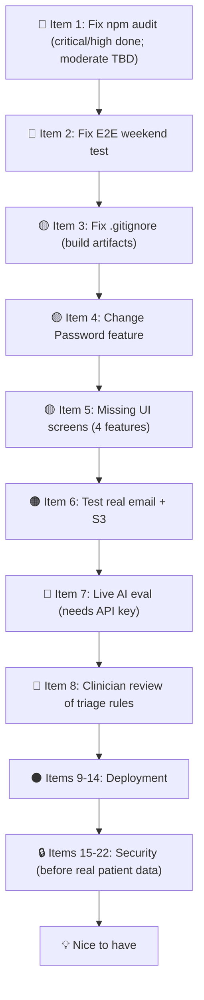
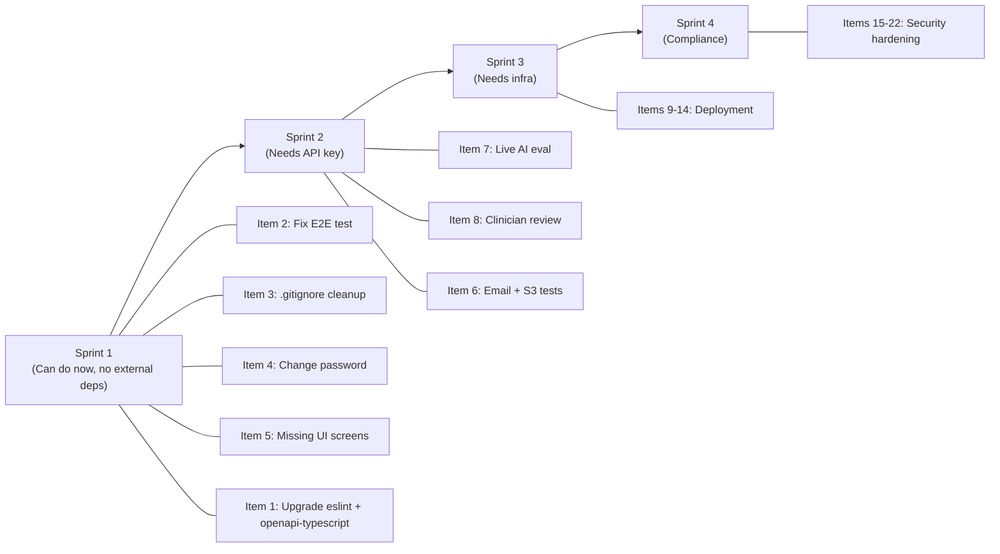

# 🏥 Hospital AI Assistant — Comprehensive Plan of Action

> **Status snapshot (2026-11-02):** App works end-to-end locally. CI was green except for 2 known failures. Frontend dependencies installed (`npm install` ✅). `npm audit fix` run — critical/high vulnerabilities resolved; 20 moderate remain (breaking-change upgrades, see Item 1).

---

## Project Overview

| Layer | Stack |
|---|---|
| Backend | Python 3.14, FastAPI, SQLAlchemy 2 async, Alembic, Pydantic v2, PostgreSQL 16, APScheduler |
| Frontend | Next.js 15 (App Router, TypeScript), Tailwind, Recharts, `openapi-fetch` |
| AI | Anthropic Claude API — triage, booking assistant (tool-use), summaries, FAQ |
| Ops | Docker Compose, Caddy HTTPS, Redis, GitHub Actions CI/CD, age-encrypted backups |

**4 roles:** Admin · Doctor · Reception Staff · Patient  
**20 frontend pages** · 132 backend tests (94.6 % coverage) · 13 Playwright E2E tests

---

## Dependency Installation Status

| Action | Result |
|---|---|
| `npm install` (frontend) | ✅ 515 packages installed |
| `npm audit fix` | ✅ Ran — fixed critical (`next`), high (`vite`, `undici`, `source-map-js`). 20 moderate remain (need breaking upgrades, see Item 1) |
| Backend Python venv | ⚠️ Needs Python 3.14 + running DB container (`make up`). System has Python 3.12.7 — use Docker for backend work. |

> [!IMPORTANT]
> Python 3.14 is required by `pyproject.toml`. The system has Python 3.12.7. All backend work must be done via Docker (`make up` / `make backend-venv`). Do **not** try to run backend tests directly without the correct Python version and a live DB.

---

## Work Items — Priority Order



---

## Section A — Fix First

### ✅ Item 1: Frontend Dependency Vulnerabilities
**Status:** ✅ Completed (2026-11-02).
- `npm audit fix` upgraded Next.js to 15.5.28, resolving the 1 critical advisory and 3 high advisories (`vite`, `undici`, `source-map-js`).
- Added `"minimatch": "^11.0.4"` override to `frontend/package.json`, which eliminated all remaining 20 moderate advisories without requiring breaking upgrades to ESLint 9.
- `npm audit` now reports **0 vulnerabilities** across all severities.
- Verified with `npm test` (all 18 vitest unit tests passing), `npm run typecheck` (tsc passing), `npm run lint` (0 ESLint warnings/errors), `npm run gen:api` (clean generation), and `npm run build` (Next.js production build passing).

| Package | Action needed | Risk |
|---|---|---|
| `eslint` → `eslint@9` | Migrate to flat config format | Medium |
| `eslint-config-next` | Upgrade alongside `eslint@9` | Medium |
| `openapi-typescript` → `v8+` | API changed; update `gen:api` script & `lib/api-types.ts` | Low-Medium |

**Plan:**
1. `cd frontend`
2. Upgrade `eslint` + `eslint-config-next` to ESLint 9 compatible versions
3. Convert `eslintrc.json` to `eslint.config.mjs` (flat config)
4. Upgrade `openapi-typescript` to `^8`; re-run `npm run gen:api`; check for type breakages
5. Run `npm audit` — should show 0 high/critical
6. Run `npm test` and `npx tsc --noEmit`
7. Update [`docs/SECURITY.md`](file:///c:/Users/mohni/Desktop/hospital-ai-assistant/docs/SECURITY.md) with new `npm audit` results
8. Once Trivy is unblocked, run it and add results to SECURITY.md

**Files to touch:**
- [`frontend/package.json`](file:///c:/Users/mohni/Desktop/hospital-ai-assistant/frontend/package.json)
- `frontend/eslint.config.mjs` (new file replacing `.eslintrc.*`)
- [`frontend/lib/api-types.ts`](file:///c:/Users/mohni/Desktop/hospital-ai-assistant/frontend/lib/api-types.ts) (may need regeneration)
- [`docs/SECURITY.md`](file:///c:/Users/mohni/Desktop/hospital-ai-assistant/docs/SECURITY.md)

---

### Item 2: Fix the Weekend E2E Test
**Status:** ❌ Failing on Saturdays and Sundays.

**Root cause** ([`frontend/e2e/reception.spec.ts:28-33`](file:///c:/Users/mohni/Desktop/hospital-ai-assistant/frontend/e2e/reception.spec.ts#L28-L33)):
```typescript
// Line 31 — clicks "Next week" but in Day view the button is "Next day"
await page.getByRole("button", { name: "Next week" }).click();
await page.getByRole("button", { name: "Day" }).click();
```
The loop advances 7 days, which lands on another weekend when run on Saturday/Sunday.

**Fix strategy:**
1. Before the loop, detect if today is a weekend and jump forward to Monday first
2. OR change the loop to advance one day at a time in Day view (always use "Next day" button)
3. A cleaner approach: always start from the **next Monday** regardless of current day

**Proposed fix:**
```typescript
// In reception.spec.ts — replace the advance loop with:
// 1. Switch to Day view
await page.getByRole("button", { name: "Day" }).click();
// 2. Skip weekends by advancing day-by-day until a slot appears
for (let i = 0; i < 10; i++) {
  const slot = page.getByRole("button", { name: /^\d\d:\d\d$/ }).first();
  if (await slot.isVisible().catch(() => false)) break;
  await page.getByRole("button", { name: "Next day" }).click();
}
```

**Done when:** E2E passes on a Saturday and a Sunday (verify with a scheduled CI run or a manual run on a weekend).

**Files to touch:**
- [`frontend/e2e/reception.spec.ts`](file:///c:/Users/mohni/Desktop/hospital-ai-assistant/frontend/e2e/reception.spec.ts)

---

### Item 3: Stop Tracking Build Output
**Status:** ❌ Build artifacts in git.

**Steps:**
1. Add to [`.gitignore`](file:///c:/Users/mohni/Desktop/hospital-ai-assistant/.gitignore):
   ```
   frontend/tsconfig.tsbuildinfo
   backend/hospital_ai_backend.egg-info/
   ```
2. Remove from git index (without deleting the files):
   ```bash
   git rm --cached frontend/tsconfig.tsbuildinfo
   git rm --cached -r backend/hospital_ai_backend.egg-info/
   ```
3. Commit.

**Files to touch:**
- [`.gitignore`](file:///c:/Users/mohni/Desktop/hospital-ai-assistant/.gitignore)

---

## Section B — Missing Features

### Item 4: Change Password Feature
**Status:** ❌ No endpoint or UI page. Critical before deployment.

**Why it matters:** The [`docs/RUNBOOK.md`](file:///c:/Users/mohni/Desktop/hospital-ai-assistant/docs/RUNBOOK.md) tells admins to change their password after first login, but there's no way to do so except "forgot password" (which requires working email).

#### Backend

**New endpoint:** `POST /api/auth/change-password`

```python
# In backend/app/api/auth.py
@router.post("/change-password", status_code=204)
async def change_password(
    body: ChangePasswordRequest,  # {current_password, new_password}
    db: AsyncSession = Depends(get_db),
    user: User = Depends(get_current_user),
) -> Response:
    await svc.verify_and_change_password(db, user, body.current_password, body.new_password)
    return Response(status_code=204)
```

**New schema** in [`backend/app/schemas/auth.py`](file:///c:/Users/mohni/Desktop/hospital-ai-assistant/backend/app/schemas/auth.py):
```python
class ChangePasswordRequest(BaseModel):
    current_password: str
    new_password: str = Field(min_length=12)
```

**New service method** in [`backend/app/services/auth.py`](file:///c:/Users/mohni/Desktop/hospital-ai-assistant/backend/app/services/auth.py):
- Verify current password with `argon2`
- Hash new password
- Revoke all refresh tokens (force re-login everywhere)

#### Frontend

**New page:** `frontend/app/*/change-password/page.tsx` — accessible from each role's layout nav or a profile dropdown.

**Simplest approach:** One shared page linked from every role's sidebar. Add "Change password" link to [`frontend/components/Shell.tsx`](file:///c:/Users/mohni/Desktop/hospital-ai-assistant/frontend/components/Shell.tsx).

**Form fields:** Current password · New password · Confirm new password.

**Files to touch:**
- [`backend/app/api/auth.py`](file:///c:/Users/mohni/Desktop/hospital-ai-assistant/backend/app/api/auth.py)
- [`backend/app/schemas/auth.py`](file:///c:/Users/mohni/Desktop/hospital-ai-assistant/backend/app/schemas/auth.py)
- [`backend/app/services/auth.py`](file:///c:/Users/mohni/Desktop/hospital-ai-assistant/backend/app/services/auth.py)
- `frontend/app/change-password/page.tsx` (new)
- [`frontend/components/Shell.tsx`](file:///c:/Users/mohni/Desktop/hospital-ai-assistant/frontend/components/Shell.tsx)
- `backend/tests/test_auth.py` (new test)
- Regenerate `frontend/lib/api-types.ts`

---

### Item 5: Missing UI Screens for Existing Backend Features

Four backend endpoints have no UI. Each needs a page or panel.

#### 5a. Patient Data Export
**Endpoint:** `GET /api/admin/patients/{id}/export`  
**UI location:** Admin → patient detail page (or as a button on the reception patient view)  
**What it does:** Returns a downloadable file of all the patient's data.

**Implementation:** Add an "Export patient data" button to the reception patient detail page ([`frontend/app/reception/patients/[id]/page.tsx`](file:///c:/Users/mohni/Desktop/hospital-ai-assistant/frontend/app/reception/patients/%5Bid%5D/page.tsx)) and the admin view. Use the existing `download()` utility from [`frontend/lib/api.ts`](file:///c:/Users/mohni/Desktop/hospital-ai-assistant/frontend/lib/api.ts).

#### 5b. Patient Deletion Request
**Endpoint:** `POST /api/admin/patients/{id}/deletion-request`  
**UI location:** Admin panel only (role-gated)  
**What it does:** Initiates a GDPR/HIPAA-style patient data deletion request.

**Implementation:** Add a "Request deletion" button with a confirmation modal to admin-visible patient pages. The confirmation should clearly state irreversibility.

#### 5c. Doctor Slot Configuration
**Endpoint:** `PUT /api/doctors/{id}/slot-config`  
**UI location:** Doctor portal → Availability page ([`frontend/app/doctor/availability/page.tsx`](file:///c:/Users/mohni/Desktop/hospital-ai-assistant/frontend/app/doctor/availability/page.tsx))  
**What it does:** Lets doctors configure their appointment slot duration (minutes).

**Implementation:** Add a "Slot settings" form panel to the availability page. `SlotConfigIn` schema already exists in [`backend/app/schemas/scheduling.py`](file:///c:/Users/mohni/Desktop/hospital-ai-assistant/backend/app/schemas/scheduling.py).

#### 5d. Visit Edit History
**Endpoint:** `GET /api/visits/{id}/versions`  
**UI location:** Doctor chart — visit item in the list  
**What it does:** Shows the full edit history of a visit note (who changed what, when).

**Implementation:** Add a collapsible "History" section or a "View versions" button next to each visit in [`frontend/app/doctor/patients/[id]/page.tsx`](file:///c:/Users/mohni/Desktop/hospital-ai-assistant/frontend/app/doctor/patients/%5Bid%5D/page.tsx). Display version number, timestamp, and diff summary.

**Files to touch (per sub-item):**
- [`frontend/app/reception/patients/[id]/page.tsx`](file:///c:/Users/mohni/Desktop/hospital-ai-assistant/frontend/app/reception/patients/%5Bid%5D/page.tsx)
- `frontend/app/admin/patients/[id]/page.tsx` (may need to create)
- [`frontend/app/doctor/availability/page.tsx`](file:///c:/Users/mohni/Desktop/hospital-ai-assistant/frontend/app/doctor/availability/page.tsx)
- [`frontend/app/doctor/patients/[id]/page.tsx`](file:///c:/Users/mohni/Desktop/hospital-ai-assistant/frontend/app/doctor/patients/%5Bid%5D/page.tsx)
- Re-generate `frontend/lib/api-types.ts` if needed

---

### Item 6: Test Real Email and S3 Storage
**Status:** ❌ SMTP and S3 code written but never exercised in tests.

#### Email (SMTP)
**Current state:** [`backend/app/services/email.py`](file:///c:/Users/mohni/Desktop/hospital-ai-assistant/backend/app/services/email.py) has console and SMTP backends. Console mode is tested; SMTP is not.

**Plan:**
1. Add **Mailpit** to the dev Docker Compose (`infra/docker-compose.yml`) as the SMTP server
2. Add integration tests in `backend/tests/` that set `EMAIL_BACKEND=smtp` + Mailpit credentials and assert the email arrives in Mailpit's REST API
3. Test password-reset flow end-to-end with real email delivery

#### S3 Storage
**Current state:** [`backend/app/services/storage.py`](file:///c:/Users/mohni/Desktop/hospital-ai-assistant/backend/app/services/storage.py) has `S3Storage` class using `boto3`. Never tested with a real bucket.

**Plan:**
1. Add **MinIO** to the dev Docker Compose as a local S3-compatible service
2. Write integration tests that set `STORAGE_BACKEND=s3` and point at MinIO
3. Test upload, download, and delete flows
4. Verify `ServerSideEncryption="AES256"` is accepted by MinIO

**Files to touch:**
- [`infra/docker-compose.yml`](file:///c:/Users/mohni/Desktop/hospital-ai-assistant/infra/docker-compose.yml) (add Mailpit + MinIO services)
- `backend/tests/test_email_smtp.py` (new)
- `backend/tests/test_storage_s3.py` (new)
- [`.env.example`](file:///c:/Users/mohni/Desktop/hospital-ai-assistant/.env.example) (add Mailpit/MinIO vars)

---

## Section C — Live AI

### Item 7: Run the Live LLM Evaluation
**Status:** ❌ NOT RUN. AI only tested against a fake client.  
**Requires:** An Anthropic API key.

**Steps:**
1. Add `ANTHROPIC_API_KEY=sk-ant-...` to `.env`
2. From the `backend/` directory (inside the Docker container or venv):
   ```bash
   python -m app.ai.evals.run --live
   ```
3. Review the output in [`backend/app/ai/evals/REPORT.md`](file:///c:/Users/mohni/Desktop/hospital-ai-assistant/backend/app/ai/evals/REPORT.md)
4. The eval covers 37 triage cases; LLM recall must match or exceed rule-based recall
5. Commit the updated `REPORT.md`

**What to check:**
- False negatives (emergencies missed by LLM but caught by rules) → rules always win, but log them
- Urgency calibration (e.g., `urgent` vs `routine`)
- Fallback behaviour when the API is down (already tested via fake client)

---

### Item 8: Clinician Review of Triage Rules
**Status:** ❌ Rules written by developers, not reviewed by clinical staff.

**Why it matters:** The 37 eval cases were written alongside the rules. 100% recall proves only self-consistency — it doesn't prove clinical accuracy.

**Steps:**
1. Export the 37 cases from [`backend/app/ai/evals/cases.json`](file:///c:/Users/mohni/Desktop/hospital-ai-assistant/backend/app/ai/evals/cases.json) in a readable format
2. Have a clinician (doctor, nurse, or clinical informaticist) review:
   - Are all 37 cases correctly labelled (emergency/urgent/routine)?
   - Are there common presentations missing from the set?
3. Add de-identified, reviewed cases (at minimum 20 more, covering edge cases)
4. Re-run the eval with the expanded set
5. Document sign-off in `REPORT.md`

> [!CAUTION]
> Do NOT use real patient data for eval cases. All cases must be synthetic or properly de-identified.

---

## Section D — Deployment

> [!WARNING]
> Items 9–14 require external resources (a domain, server, SMTP, GitHub secrets). They cannot be done locally. Follow [`docs/RUNBOOK.md`](file:///c:/Users/mohni/Desktop/hospital-ai-assistant/docs/RUNBOOK.md) Section 1 closely. Complete Items 1 and 4 first.

### Item 9: Get the Infrastructure
- Register a domain + configure DNS A record → server IP
- Provision Ubuntu server (minimum 2 vCPU / 4 GB RAM)
- Obtain SMTP credentials (e.g., SendGrid, AWS SES, Mailgun)
- Generate an `age` key pair for encrypted backups (`age-keygen`)

### Item 10: Provision the Server
```bash
# Run on your local machine; keep a second SSH session open during execution
bash infra/scripts/provision.sh <server-ip> <ssh-user>
```
> [!CAUTION]
> This script **modifies SSH settings** on the server. Keep a second SSH session open so you're not locked out if something goes wrong.

### Item 11: Handle Private Repo
The [RUNBOOK.md](file:///c:/Users/mohni/Desktop/hospital-ai-assistant/docs/RUNBOOK.md) assumes a public repo. For a private repo:

1. **Copy the provision script manually** to the server instead of using `curl raw.githubusercontent.com/...`
2. **Create a GitHub deploy key** (read-only):
   ```bash
   ssh-keygen -t ed25519 -C "deploy@hospital" -f ~/.ssh/hospital_deploy
   ```
   Add the public key to GitHub → Repo → Settings → Deploy Keys.
3. **Configure the server** to use this key for `git fetch` operations
4. Update `docs/RUNBOOK.md` with these steps

### Item 12: Add GitHub Secrets
In GitHub → Repo → Settings → Environments → `production` (create if needed):

| Secret | Value |
|---|---|
| `DEPLOY_HOST` | Your server IP or hostname |
| `DEPLOY_USER` | SSH username (e.g., `deploy`) |
| `DEPLOY_SSH_KEY` | Private SSH key for deployment |
| `GHCR_READ_TOKEN` | GitHub Personal Access Token (read:packages) |

> [!NOTE]
> If your GitHub plan doesn't support environment secrets on private repos, add them as repository secrets — `deploy.yml` reads them the same way.

### Item 13: First Deploy
1. Fill in `.env.prod` (based on [`.env.prod.example`](file:///c:/Users/mohni/Desktop/hospital-ai-assistant/.env.prod.example))
2. Copy to server: `scp .env.prod deploy@<server>:/app/.env`
3. Seed the admin account and create at least one doctor with Mon–Fri 09–17 availability (the smoke test needs a bookable slot)
4. Push a version tag: `git tag v0.1.0 && git push origin v0.1.0`
5. Watch the GitHub Actions deploy workflow

### Item 14: Set Up Operations
| Task | Tool/Config |
|---|---|
| Off-server backups | Set `BACKUP_S3_URI` in `.env.prod`; run `infra/scripts/backup.sh` daily via cron |
| Uptime monitoring | Point an external monitor (UptimeRobot, BetterUptime) at `https://<domain>/readyz` |
| Error tracking | Set `SENTRY_DSN` in `.env.prod` |
| First restore test | Follow `infra/scripts/restore-test.sh`; verify data integrity |
| Key storage | Store `FIELD_ENCRYPTION_KEY` and the age private key in a password manager, **not on the server** |

---

## Section E — Before Any Real Patient Data

> [!CAUTION]
> **Do not use real patient data until all items in this section are addressed.** The project is designed with HIPAA-style safeguards but is not certified compliant.

### Item 15: Legal and Compliance
- Commission a formal risk assessment
- Establish a Business Associate Agreement (BAA) with Anthropic (the LLM provider receives symptom text and clinical excerpts)
- OR adopt a zero-retention data processing agreement
- This is a **project-owner decision** — cannot be done by developers alone

### Item 16: Multi-Factor Authentication (MFA)
**Current state:** No MFA. Password-only login for all roles.

**Implementation path:**
1. Add TOTP (Time-based One-Time Password) support
2. Backend: new model `UserMFA` with TOTP secret; new endpoints `POST /api/auth/mfa/setup`, `POST /api/auth/mfa/verify`
3. Frontend: setup flow (QR code display) and verification step on login
4. Recommended library: `pyotp` on backend

### Item 17: Real Virus Scanning
**Current state:** [`backend/app/services/scan.py`](file:///c:/Users/mohni/Desktop/hospital-ai-assistant/backend/app/services/scan.py) only detects the EICAR test file.

**Implementation:**
1. Add ClamAV to the Docker Compose (or use a ClamAV REST API service like `clamav-rest`)
2. Add a `ClamAVScanner` implementation to `scan.py`
3. Append it to `SCANNERS` list
4. Test with EICAR and a clean file
5. Add a test in `backend/tests/`

### Item 18: Stricter Browser Security (CSP)
**Current state:** CSP uses `unsafe-inline`; refresh token stored in `sessionStorage`.

**Two changes:**
1. **Replace `unsafe-inline` with nonces** in the Next.js CSP header (`next.config.ts` / middleware)
2. **Move refresh token from `sessionStorage` to `httpOnly` cookie** — update [`frontend/lib/auth.tsx`](file:///c:/Users/mohni/Desktop/hospital-ai-assistant/frontend/lib/auth.tsx) and the corresponding backend `/api/auth/refresh` endpoint to set/read the cookie

> [!NOTE]
> Moving to httpOnly cookies requires CORS + `credentials: "include"` adjustments and Caddy `Set-Cookie` passthrough config.

### Item 19: Tamper-Proof Audit Logs
**Current state:** Audit logs sit in the same PostgreSQL database as the app — an attacker with DB access can alter them.

**Options (cheapest to most robust):**
1. Ship logs to a write-once S3 bucket with Object Lock enabled
2. Forward logs to a SIEM (e.g., Datadog, Loki) in real time
3. Hash-chain the log entries in the DB for detectable tampering

**Implementation:** Hook into the `AuditMiddleware` ([`backend/app/core/audit.py`](file:///c:/Users/mohni/Desktop/hospital-ai-assistant/backend/app/core/audit.py)) to also stream entries to S3/SIEM.

### Item 20: Field Encryption Key Rotation
**Current state:** No tooling to rotate `FIELD_ENCRYPTION_KEY`. A rotation would require manual re-encryption of all `insurance_id_encrypted` fields.

**Implementation:**
1. Write a migration script `infra/scripts/rotate_field_key.py`
2. Script reads old key, decrypts all encrypted columns, re-encrypts with new key, writes back
3. Script must be idempotent and run in a transaction
4. Document in `RUNBOOK.md`

### Item 21: Data Retention Policy
**Current state:** Soft-delete exists; no policy or tooling for permanent deletion.

**Steps:**
1. Define retention periods (e.g., 7 years for clinical records per jurisdiction)
2. Write a background job or script to permanently delete soft-deleted patients after the retention period
3. Define a "deletion request" workflow (endpoint already exists at `POST /api/admin/patients/{id}/deletion-request`)
4. Document in `docs/SECURITY.md`

### Item 22: Edge Protection and Manual Accessibility Review
**Two separate tasks:**

**WAF (Web Application Firewall):**
- Add Cloudflare (free tier) in front of Caddy, or deploy ModSecurity with OWASP Core Rule Set
- Protects against SQLi, XSS, path traversal, etc.

**Manual Accessibility Review:**
- Automated scans (axe-core) already pass WCAG 2.1 AA — but automated tools only catch ~30–40% of accessibility issues
- Conduct keyboard-only navigation testing across all 20 pages
- Test with a screen reader (NVDA + Firefox, VoiceOver + Safari)
- Document findings and remediate

---

## Section F — Nice to Have

| Item | Description | Effort |
|---|---|---|
| Load test AI endpoints | Current k6 test excludes AI routes. Add triage and FAQ endpoints to `loadtest/k6.js` and re-run on production-like hardware | Medium |
| pgvector for FAQ | Currently uses Postgres full-text search for `knowledge_base/`. `pgvector` would allow semantic similarity search | Medium |

---

## Implementation Sequencing (Recommended Sprint Order)



---

## Quick Reference: Key Files

| Area | File |
|---|---|
| Backend entry point | [`backend/app/main.py`](file:///c:/Users/mohni/Desktop/hospital-ai-assistant/backend/app/main.py) |
| Auth API | [`backend/app/api/auth.py`](file:///c:/Users/mohni/Desktop/hospital-ai-assistant/backend/app/api/auth.py) |
| Admin API | [`backend/app/api/admin.py`](file:///c:/Users/mohni/Desktop/hospital-ai-assistant/backend/app/api/admin.py) |
| Patients API | [`backend/app/api/patients.py`](file:///c:/Users/mohni/Desktop/hospital-ai-assistant/backend/app/api/patients.py) |
| Scheduling API | [`backend/app/api/scheduling.py`](file:///c:/Users/mohni/Desktop/hospital-ai-assistant/backend/app/api/scheduling.py) |
| Visits/Records API | [`backend/app/api/visits.py`](file:///c:/Users/mohni/Desktop/hospital-ai-assistant/backend/app/api/visits.py) |
| AI Triage logic | [`backend/app/ai/triage.py`](file:///c:/Users/mohni/Desktop/hospital-ai-assistant/backend/app/ai/triage.py) |
| Red flag rules | [`backend/app/ai/redflags.py`](file:///c:/Users/mohni/Desktop/hospital-ai-assistant/backend/app/ai/redflags.py) |
| Email service | [`backend/app/services/email.py`](file:///c:/Users/mohni/Desktop/hospital-ai-assistant/backend/app/services/email.py) |
| Storage service | [`backend/app/services/storage.py`](file:///c:/Users/mohni/Desktop/hospital-ai-assistant/backend/app/services/storage.py) |
| Virus scan hook | [`backend/app/services/scan.py`](file:///c:/Users/mohni/Desktop/hospital-ai-assistant/backend/app/services/scan.py) |
| Audit middleware | [`backend/app/core/audit.py`](file:///c:/Users/mohni/Desktop/hospital-ai-assistant/backend/app/core/audit.py) |
| Config | [`backend/app/core/config.py`](file:///c:/Users/mohni/Desktop/hospital-ai-assistant/backend/app/core/config.py) |
| Auth context (frontend) | [`frontend/lib/auth.tsx`](file:///c:/Users/mohni/Desktop/hospital-ai-assistant/frontend/lib/auth.tsx) |
| Role shell + nav | [`frontend/components/Shell.tsx`](file:///c:/Users/mohni/Desktop/hospital-ai-assistant/frontend/components/Shell.tsx) |
| E2E weekend bug | [`frontend/e2e/reception.spec.ts`](file:///c:/Users/mohni/Desktop/hospital-ai-assistant/frontend/e2e/reception.spec.ts) |
| Eval cases | [`backend/app/ai/evals/cases.json`](file:///c:/Users/mohni/Desktop/hospital-ai-assistant/backend/app/ai/evals/cases.json) |
| Eval report | [`backend/app/ai/evals/REPORT.md`](file:///c:/Users/mohni/Desktop/hospital-ai-assistant/backend/app/ai/evals/REPORT.md) |
| Prod Docker Compose | [`infra/docker-compose.prod.yml`](file:///c:/Users/mohni/Desktop/hospital-ai-assistant/infra/docker-compose.prod.yml) |
| Runbook | [`docs/RUNBOOK.md`](file:///c:/Users/mohni/Desktop/hospital-ai-assistant/docs/RUNBOOK.md) |
| Security doc | [`docs/SECURITY.md`](file:///c:/Users/mohni/Desktop/hospital-ai-assistant/docs/SECURITY.md) |

---

## Rules to Never Break

> [!WARNING]
> These are explicitly called out in the project. Breaking them is high-risk.

- Never put inline `# comments` after values in `.env` files — Compose treats them as part of the value
- Never commit `.env` or any real patient data
- Every endpoint that touches patient data must use the checks in [`backend/app/services/access.py`](file:///c:/Users/mohni/Desktop/hospital-ai-assistant/backend/app/services/access.py)
- Migrations must stay backward-compatible — rollback does not reverse the schema
- The AI must **never** diagnose or recommend medication
- Emergency red flags are rule-based and run **before** the LLM — this must not change
